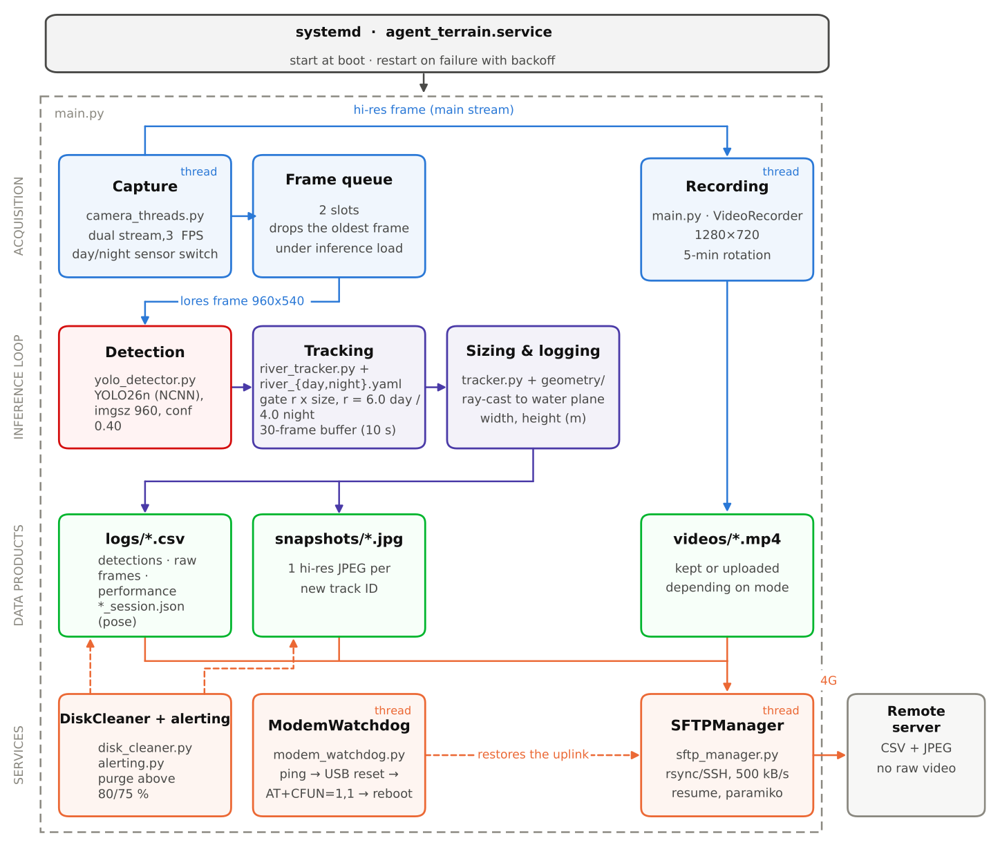

# ROV-E — River Observation and Vision Equipment 

[](https://www.python.org/)
[](https://www.raspberrypi.com/)
[](https://ultralytics.com)
[](./LICENSE)

Embedded software for an autonomous riverside station that counts and sizes floating debris on a **Raspberry Pi 5**, and transmits its results over 4G.

This repository is the deployment and operation manual for the instrument. The method and the measurement results are described in the accompanying HardwareX article.

---

## 🏗️ System Architecture



The agent is a single Python process supervised by systemd. One thread drives the camera, one records the video, three run in the background (modem watchdog, upload manager, disk cleaner), and the main loop chains detection, tracking, sizing and logging on every frame. Only CSV files and JPEG snapshots travel over 4G; raw video never leaves the SD card.

---

## ⚙️ Hardware Requirements

1.  **Single-board computer**: Raspberry Pi 5. **4 GB is enough** (measured footprint: 950 MB resident, 1.15 GB for the whole system).
2.  **Cameras**:
    *   1× Raspberry Pi Camera Module 3 (RGB, IMX708) — CSI port, enumerated as camera 0.
    *   1× Raspberry Pi Camera Module 3 NoIR (IMX708) — CSI port, enumerated as camera 1.
    *   ⚠️ The Pi 5 takes the **narrow 22-pin** flat cable; the Pi 4 cable does not fit.
3.  **4G modem**: Waveshare SIM7600G-H over USB, driven by NetworkManager and ModemManager.
4.  **Storage**: U3/V30 microSD, **64 GB minimum** (the Python environment alone takes about 5 GB).
5.  **Power**: official 27 W USB-C supply, required for two cameras plus the modem.
6.  **OS**: 64-bit Raspberry Pi OS (Debian 13, Python 3.13).

---

## 📁 File Structure

```text
River-Observation-and-Vision-Equipment/
├── camera/                      # PiCamera2 acquisition
│   └── camera_threads.py        # Dual-stream CameraThread (lores AI / main hi-res)
│                                # Deadline-based pacing, drop-oldest queue
├── detection/                   # Detection and tracking
│   ├── river_tracker.py         # RiverTracker: size-normalised distance ByteTrack
│   ├── tracker.py               # ObjectTracker: track state, averaging, CSV logging
│   └── yolo_detector.py         # Ultralytics wrapper, registers the `river` type
├── geometry/                    # 3D optical model
│   ├── camera_model.py          # Pinhole: FOV, K matrix, yaw/pitch rotation
│   ├── intersection.py          # Raycast: ray-plane intersection, diameters
│   ├── plane.py                 # Plane class: normal, offset, signed distance
│   ├── size_estimator.py        # estimate_size_m(): bbox → (width_m, height_m)
│   └── utils.py                 # get_box_vertices_2D(): key points of a bbox
├── models_yolo26n/              # Deployed weights, NCNN exports
│   ├── yolo26n_day_best_ncnn_model/
│   └── yolo26n_night_best_ncnn_model/
├── utils/
│   ├── configs.py               # ⚙️ All settings, including the camera pose
│   ├── logging_utils.py         # CSVLogger, PerformanceLogger, session record
│   ├── sftp_manager.py          # Async upload rsync/paramiko, retry, watchdog
│   ├── modem_watchdog.py        # 4G monitoring, escalating repair
│   ├── disk_cleaner.py          # Recursive purge above 80 %
│   └── alerting.py              # Alert files, transmitted with the data
├── docs/                        # Documentation assets
├── logs/                        # CSV, session records, alerts (created on demand)
├── videos/                      # Videos and snapshots (created on demand)
├── main.py                      # Field agent: main loop, sessions, snapshots
├── run_agent.sh                 # Supervisor: restart on crash, log rotation
├── setup_agent.sh               # Installation wizard and systemd service
├── river_day.yaml               # Tracker settings, diurnal regime
├── river_night.yaml             # Tracker settings, nocturnal regime
└── requirements.txt             # Pinned Python dependencies
```

---

## 🛠️ Installation and Deployment

### 1. Clone the repository on the Raspberry Pi 5

```bash
git clone https://github.com/g-grimmer/River-Observation-and-Vision_Equipment.git ROV-E
cd ROV-E
```

### 2. Run the installation wizard as `root`

```bash
chmod +x setup_agent.sh run_agent.sh
sudo ./setup_agent.sh
```

> Run it with `sudo` **from your own session**, not from a root shell opened with `sudo -i`: the script reads `SUDO_USER` to decide which account runs the service.

The wizard will:
*   Rename the agent (machine hostname, to identify it on the network).
*   Ask for the NAS credentials and write them into `utils/configs.py`.
*   Offer a choice of **4G upload mode** (see next section).
*   Offer automatic **GSM / 4G configuration** (NetworkManager, ModemManager, APN, SIM PIN).
*   Lift the USB current limits in `/boot/firmware/config.txt` for the modem.
*   Install `rsync`, `sshpass` and the **camera stack** `python3-picamera2`.
*   Create the Python environment and install `requirements.txt`.
*   Write a **restricted** `sudoers` rule for the watchdog (never a full shell).
*   Create and enable the `agent_terrain.service` unit.

If the script changed the USB current limits, **a reboot is required** before starting the agent.

```bash
sudo reboot
sudo systemctl start agent_terrain
sudo journalctl -u agent_terrain -f
```

> ⚠️ **Never re-run `setup_agent.sh` on a station already deployed**: it deletes and rebuilds the Python environment, which means several gigabytes over the mobile link. See "Updating a Deployed Station".

### 3. Choosing the 4G Upload Mode

| Mode                               | CLI argument                     | Behaviour                                                        |
| :--------------------------------- | :------------------------------- | :--------------------------------------------------------------- |
| **Snapshot** *(recommended on 4G)* | `--upload-mode snapshot`         | No video. One annotated JPEG per new `track_id`. Minimal volume. |
| **Video (filtered)**               | `--upload-mode video`            | Upload if the session had detections, delete locally otherwise.  |
| **Video (keep all)**               | `--upload-mode video --keep-all` | Upload **every** video, even without detections.                 |
| **Video + Snapshot**               | `--upload-mode video+snapshot`   | Video kept locally (never uploaded), JPEG sent over 4G.          |

> **Snapshot deduplication**: one JPEG per unique `track_id` **per session**. The list resets at every rotation, so an object motionless in the field of view is photographed again every 5 minutes.

Switching modes without reinstalling:

```bash
sudo nano /etc/systemd/system/agent_terrain.service
# edit the end of the ExecStart line, then:
sudo systemctl daemon-reload && sudo systemctl restart agent_terrain
```

### 4. GSM / 4G Connection Setup

If you enable this option in `setup_agent.sh`:

1.  **System packages**: `network-manager` and `modemmanager`.
2.  **Cellular profile**: a connection named `4G-Mobile` created through `nmcli`.
3.  **Resilient settings**:
    *   `connection.autoconnect yes` — automatic reconnection on signal loss.
    *   `ipv4.route-metric 10` — 4G becomes the default route, ahead of Ethernet.
    *   `connection.wait-device-timeout 30` — gives the modem time to appear at boot.
4.  **Network watchdog (`ModemWatchdog`)**, a background thread that pings `8.8.8.8` bound to the cellular interface, then escalates: interface down/up, hardware USB reset, `AT+CFUN=1,1` firmware reset, NetworkManager reconnection. Exponential backoff after a complete failure, and an alert file transmitted to the NAS as soon as the link returns.
5.  **Disk cleaner (`DiskCleaner`)**: above **80 %** occupancy, recursively purges the oldest files until back down to **75 %**.

---

## ⚙️ Configuration Parameters

Everything lives in `utils/configs.py`.

```bash
nano utils/configs.py
sudo systemctl restart agent_terrain    # apply
```

### Site-specific values — to be surveyed at installation

The defaults are bench values. Counts and trajectories stay valid without them, sizes in metres do not.

| Parameter                                            | Default        | Note                                                                         |
| ---------------------------------------------------- | -------------- | ---------------------------------------------------------------------------- |
| `CAMERA_HAUTEUR_M`                                   | `2.7`          | measure above the water on the day of installation                           |
| `CAMERA_TANGAGE_DEG`                                 | `-19.0`        | tilt, negative downwards                                                     |
| `PORTEE_MAX_M`                                       | `20.0`         | distance to the far bank; beyond it the rays graze and the estimate diverges |
| `CAMERA_FOCALE_MM`                                   | `4.74`         | Camera Module 3, change only with a different lens                           |
| `CAMERA_CAPTEUR_MM`                                  | `(6.45, 3.63)` | Camera Module 3, idem                                                        |
| `SFTP_HOST` / `USERNAME` / `PASSWORD` / `REMOTE_DIR` | blank          | written by the installer                                                     |


### General settings

| Parameter                   | Default                 | Description                             | Recommended values                           |
| --------------------------- | ----------------------- | --------------------------------------- | -------------------------------------------- |
| `ROTATION_MINUTES`          | `5`                     | session length                          | `5` (4G) / `15` (WiFi)                       |
| `CONFIDENCE`                | `0.10`                  | detector threshold                      | deliberately permissive, the tracker filters |
| `VIDEO_FPS` / `CAPTURE_FPS` | `3.0`                   | acquisition and analysis rate           | `3` (333 ms per frame budget)                |
| `HI_RES_SIZE`               | `(1280, 720)`           | video and snapshot resolution           | `(1920, 1080)` with wide bandwidth           |
| `FRAME_SIZE`                | `(960, 540)`            | AI stream                               | ⚠️ **do not change**: must stay 16:9          |
| `IMGSZ`                     | `960`                   | inference resolution                    | fixed by the NCNN export                     |
| `HEURE_JOUR_DEBUT` / `FIN`  | `7` / `19`              | diurnal window, camera 0                | adjust to season and site                    |
| `VIDEO_CODEC`               | `"mp4v"`                | video codec                             | `"mp4v"` or `"avc1"`                         |
| `max_move_ratio` *(YAML)*   | `6.0` day / `4.0` night | tracker gate, in object sizes per frame | leave as deployed                            |

---

## 🎮 Operation and Supervision Commands

### Manual run (outside the service)

```bash
cd ~/ROV-E
PYTHONUNBUFFERED=1 ./run_agent.sh --upload-mode snapshot
```

> `PYTHONUNBUFFERED=1` is essential when running by hand: without it the agent output is buffered behind the supervisor's `tee` and nothing appears for a minute.

### Managing the system service

```bash
# Start the agent
sudo systemctl start agent_terrain

# Stop the agent
sudo systemctl stop agent_terrain

# Restart (e.g. after a configuration change)
sudo systemctl restart agent_terrain

# Current state (active / failed / inactive)
systemctl status agent_terrain --no-pager

# Live logs
sudo journalctl -u agent_terrain -f

# Last 50 lines
sudo journalctl -u agent_terrain -n 50 --no-pager

# Enable / disable start at boot
sudo systemctl enable agent_terrain
sudo systemctl disable agent_terrain

# Show the service configuration (path, upload mode)
grep -E "User|WorkingDirectory|ExecStart" /etc/systemd/system/agent_terrain.service
```

### Reading the status line

Every 10 seconds the agent summarises its state:

```
📊 [Cam 0] FPS: 3.0 | AI: 163.9ms | Frame: 25 | Session: 0min | Snaps: 2 | Modem: ✅ | Recoveries: 0
```

| Field        | Expected       | Warning sign                                               |
| ------------ | -------------- | ---------------------------------------------------------- |
| `FPS`        | `3.0`          | sustained below 2.5                                        |
| `AI`         | 157 to 175 ms  | close to 460 ms → the PyTorch weights are in use, not NCNN |
| `Snaps`      | site dependent | rising fast → check the 4G volume                          |
| `Modem`      | `✅`            | `⚠️ n failure(s)`                                           |
| `Recoveries` | `0`            | increasing → unstable 4G link                              |

### Commissioning checklist

1. Both cameras detected, and the right one is camera 0: `rpicam-hello --list-cameras`, then `rpicam-hello --camera 0 --timeout 3000`. If they are swapped, the instrument observes daylight with the infrared sensor without reporting any error.
2. Camera pose surveyed and written to `utils/configs.py`.
3. 4G link up and preferred over any wired fallback: `ip route show default` must show the modem interface with the lower metric.
4. First transfer confirmed in the journal: a successful upload followed by the local file being removed.
5. `vcgencmd get_throttled` returns `0x0`.

---

## 📈 Output File Formats

A session lasts 5 minutes and produces **three files**, transmitted at rotation.

### 1. Detections — `logs/camX_<model>_<timestamp>_detections.csv`

**One row per confirmed track**, written at the first frame on which the geometry returns a usable size. One reported object = one row.

```csv
timestamp,frame_id,camera_id,track_id,class_id,confidence,x1_rel,y1_rel,x2_rel,y2_rel,width_m,height_m,avg_width_m,avg_height_m,track_age
2026-10-15T14:41:27.446,105,0,3,0,0.42,0.3125,0.4815,0.3646,0.5370,0.21,0.14,0.22,0.15,7
```

| Column                        | Description                                                                     |
| ----------------------------- | ------------------------------------------------------------------------------- |
| `timestamp`                   | ISO 8601, local time                                                            |
| `frame_id`                    | frame index within the session                                                  |
| `camera_id`                   | `0` diurnal, `1` nocturnal                                                      |
| `track_id`                    | persistent identity assigned by the tracker                                     |
| `class_id`, `confidence`      | detector output                                                                 |
| `x1_rel … y2_rel`             | box in **relative coordinates** (0 to 1), independent of resolution             |
| `width_m`, `height_m`         | size on that frame; `NaN` outside the measurable zone, never a numeric sentinel |
| `avg_width_m`, `avg_height_m` | size averaged over the whole track                                              |
| `track_age`                   | number of frames the track has been seen                                        |

### 2. Performance — `logs/camX_<model>_<timestamp>_performance.csv`

Every 10 seconds:

```csv
timestamp,cam_fps,inference_ms,cpu_temp_c,cpu_load_pct,cpu_freq_mhz,ram_usage_pct
2026-10-15T15:24:50.189,3.0,163.9,57.3,44.4,2400,7.4
```

> `-1` in temperature or frequency signals a **read failure**, not a real value.

### 3. Session record — `logs/camX_<model>_<timestamp>_session.json`

Camera pose and inference settings for that session.

```json
{
  "session": "cam0_..._session.json",
  "date": "2026-10-15T15:24:50",
  "pose": {
    "hauteur_m": 2.7,
    "tangage_deg": -19.0,
    "focale_mm": 4.74,
    "capteur_mm": [6.45, 3.63],
    "resolution_px": [960, 540]
  },
  "inference": {
    "modele": ".../yolo26n_day_best_ncnn_model",
    "tracker": ".../river_day.yaml",
    "imgsz": 960,
    "confidence": 0.1,
    "capture_fps": 3.0
  }
}
```

### 4. Snapshots — `videos/camX_<timestamp>_snap.jpg`

High-resolution JPEG annotated with the box, class, confidence, track identity and an overlaid timestamp. About **56 kB** per image. Deleted locally as soon as the transfer succeeds.

---

## 📖 Command Reference

### 📶 Managing the 4G connection

```bash
# Active connections (the 4G-Mobile profile must appear)
nmcli -t -f NAME,TYPE,DEVICE,STATE con show --active

# Check that 4G carries the default route (lowest metric)
ip route show default

# Restart the connection manually
sudo nmcli con down "4G-Mobile" && sudo nmcli con up "4G-Mobile"

# Test connectivity through the modem only
ping -c 5 -I wwan0 8.8.8.8

# Detected modems, then details (operator, signal, technology)
mmcli -L
mmcli -m 0 | grep -iE "state|signal quality|access tech|operator name"

# Traffic exchanged since the interface came up
ip -s link show wwan0

# Change the APN (different SIM card)
sudo nmcli connection modify "4G-Mobile" gsm.apn "new.apn"
sudo nmcli con down "4G-Mobile" && sudo nmcli con up "4G-Mobile"
```

### 🐛 Diagnostics and troubleshooting

```bash
# Detected cameras, and which one is camera 0
rpicam-hello --list-cameras
rpicam-hello --camera 0 --timeout 3000

# CPU health: 0x0 = no throttling and no under-voltage since boot
vcgencmd get_throttled
vcgencmd measure_temp

# Disk space and size of the data folders
df -h /
du -sh ~/ROV-E/videos ~/ROV-E/logs

# Files waiting to be sent, and those set aside after 20 failures
ls ~/ROV-E/videos | wc -l
ls ~/ROV-E/logs/failed ~/ROV-E/videos/failed 2>/dev/null

# Alerts written by the agent (camera, modem, fatal error)
ls ~/ROV-E/logs/ALERTE_* 2>/dev/null && cat ~/ROV-E/logs/ALERTE_*

# Supervisor history: restarts, crashes, camera re-acquisitions
grep -E "Supervisor started|crashed|silent for more than" ~/ROV-E/logs/supervisor.log | tail -20

# Confirm NCNN is the engine actually in use
sudo journalctl -u agent_terrain | grep -i "for NCNN inference"
```

### 🔧 Common changes without reinstalling

```bash
# NAS credentials
nano utils/configs.py     # SFTP_HOST, SFTP_USERNAME, SFTP_PASSWORD, SFTP_REMOTE_DIR
sudo systemctl restart agent_terrain

# Remove the watchdog's reboot right (recommended on a remote site)
sudo tee /etc/sudoers.d/agent_terrain_watchdog <<EOF
$USER ALL=(root) NOPASSWD: /usr/sbin/ip link set * up, /usr/sbin/ip link set * down, /usr/bin/ip link set * up, /usr/bin/ip link set * down, /usr/bin/tee /sys/bus/usb/devices/*/authorized
EOF
sudo chmod 0440 /etc/sudoers.d/agent_terrain_watchdog && sudo visudo -c

# Enable resumable transfers
sudo apt-get install -y rsync sshpass     # on the Raspberry Pi
# and install rsync on the NAS, otherwise the SFTP fallback restarts any interrupted file
```

---

## 🔄 Updating a Deployed Station

**Never** re-run the installation wizard on a station in service. Install the new version alongside the old one, test it, then switch the service over. The old folder stays intact and serves as an immediate rollback.

```bash
# 1. Free the disk below 70 % BEFORE switching.
#    Otherwise the cleaner, which reads whole-filesystem occupancy but only purges
#    its own folders, would delete the new version's data in a loop.
df -h / | tail -1

# 2. Clone alongside and reuse the existing Python environment
cd ~ && git clone --depth 1 https://github.com/g-grimmer/River-Observation-and-Vision_Equipment.git ROV-E-new
ln -s $HOME/ROV-E/.venv $HOME/ROV-E-new/.venv
source ~/ROV-E/.venv/bin/activate
pip install --no-deps ncnn==1.0.20260526

# 3. Carry the server credentials and the camera pose over into
#    ~/ROV-E-new/utils/configs.py

# 4. Test by hand, service stopped
sudo systemctl stop agent_terrain
cd ~/ROV-E-new && PYTHONUNBUFFERED=1 ./run_agent.sh --upload-mode snapshot

# 5. Switch over if conclusive
sudo sed -i 's|/ROV-E/|/ROV-E-new/|g' /etc/systemd/system/agent_terrain.service
sudo systemctl daemon-reload && sudo systemctl start agent_terrain
```

> ⚠️ The Python environment stays **physically in the old folder**, which must therefore never be deleted.

---

## 📚 Citation

If you use this instrument or its software, please cite the associated HardwareX article. Machine-readable metadata is provided in [`CITATION.cff`](./CITATION.cff), which GitHub exposes through the "Cite this repository" button.

---

## 📝 License

Distributed under the **GNU Affero General Public License v3.0**. See [`LICENSE`](./LICENSE) for the full text.
